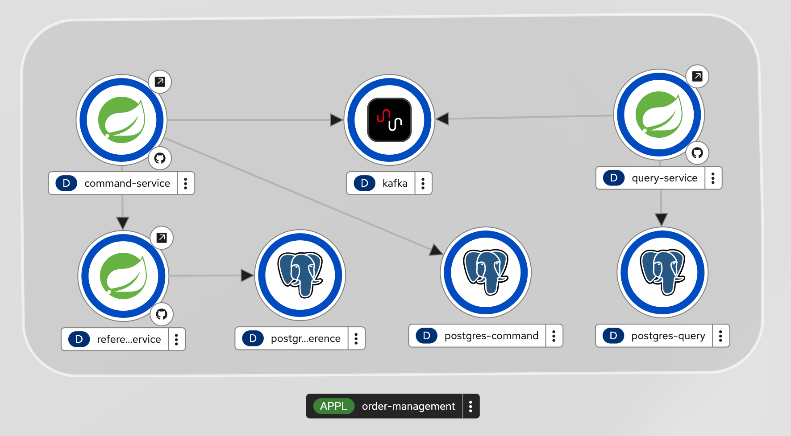

# order-management-cqrs-api

REST API for managing orders: **Person, Address, Item, Order, Payment, Delivery**, all persisted in PostgreSQL.
Version 2.0.0.

The API is built for a web UI generated from its OpenAPI contract (`contract/openapi.json`) with
[crud-ui-blueprint](https://github.com/mmartofel/crud-ui-blueprint), and follows that UI's contract,
`docs/API-CONTRACT.md`. Persons, addresses and items are **CRUD resources** (its sections 2-9). Orders, payments and
deliveries are **command resources** (section 11). The deployment follows `docs/DEPLOY-CONVENTION.md`. Both files
are copied unchanged from the UI template.

## Repository layout

```
.
├── pom.xml                              # Maven parent (Spring Boot 4.1.2, Axon BOM 5.4.1), lists the modules
├── mvnw, .mvn/                          # Maven wrapper; no local Maven needed
├── order-management-events/             # event records shared by the command and query services
├── order-management-command-service/    # writes: Axon entities, command handlers, Kafka relay
├── order-management-query-service/      # reads: Kafka listeners, projections, read models, GET endpoints
├── order-management-reference-service/  # Person, Address, Item CRUD
├── order-management-gateway/            # one origin for the UI: routes by method, merged contract, health
├── contract/openapi.json                # the merged contract the UI is generated from; CI checks it is current
├── docker-compose.yml                   # local PostgreSQL x3, Kafka and Keycloak
├── deploy/, skaffold.yaml               # OpenShift / Kubernetes manifests (Kustomize) and image build + deploy
├── docs/API-CONTRACT.md                 # the UI's contract rules, copied unchanged from crud-ui-blueprint
├── docs/DEPLOY-CONVENTION.md            # the deployment shared with the UI repo, copied unchanged
├── docs/images/                         # pictures used in this README
├── .github/workflows/ci.yml             # build and test on every push and pull request
└── CLAUDE.md                            # architecture decisions (style, scope, topology, event store)
```

Inside each service the code is organised by aggregate (`order`, `payment`, `delivery`, `person`, ...). The packages
are `domain` (event-sourced entities), `command` (commands, handlers, command controller), `projection` (Kafka
listeners) and `query` (read models, query handlers, query controller). Database migrations are under
`src/main/resources/db/migration`.

Order, Payment and Delivery use **CQRS + Event Sourcing** with [Axon Framework](https://www.axoniq.io) 5.4.1. Commands go to a
command service, which stores events. The events reach a separate query service through Kafka, and the query
service serves the reads. Person, Address and Item are reference data, kept as plain layered CRUD in their own service.

```
                    POST /api/{orders,payments,deliveries}[/{id}/<action>]
              ┌──────────────────────────────────► command-service :8083 ──┐
              │                                     Axon event store       │ events
client ──► gateway :8081                                                   ▼ (Kafka)
   │          │ GET /api/{orders,payments,deliveries}[/{id}]
   │          ├──────────────────────────────────► query-service :8084, read models
   │          │ /api/{persons,addresses,items}            │ labels
   │          └──────────────────────────────────► reference-service :8082 ◄───┘
   │                                                CRUD; the command service checks references here
   └── bearer token from Keycloak :8080 (realm orders)
```

The UI sees one origin, the gateway, and one contract. Commands and queries share their paths, so the gateway tells
them apart by HTTP method. Every service checks the bearer token itself.

| Module | Port (local) | Database | Role |
|---|---|---|---|
| `order-management-events` | - | - | Event records, status enums and the actions rules; the contract between command and query services. No Spring |
| `order-management-gateway` | 8081 | - | `GET` to the query service, other methods to the command service, reference data to the reference service; one health component per service; `contract/openapi.json` at `/v3/api-docs` |
| `order-management-reference-service` | 8082 | `orders_reference` (5434) | CRUD for Person, Address, Item |
| `order-management-command-service` | 8083 | `orders_command` (5432) | Axon event-sourced Order, Payment, Delivery; command endpoints; relays events to Kafka |
| `order-management-query-service` | 8084 | `orders_query` (5433) | Kafka consumers, read models, `GET` endpoints |

Keycloak listens on 8080, as for every API made for crud-ui-blueprint. In a cluster the services keep 8080 (command),
8081 (query) and 8082 (reference), and the gateway is the Service `order-management` on 8080.

Stack: Java 21, Spring Boot 4.1.2, Axon Framework 5.4.1, Spring Cloud Gateway Server Web MVC (Spring Cloud 2025.1.4),
springdoc 3.2, Keycloak 26.8, PostgreSQL 18, Apache Kafka 4.1, Flyway, Testcontainers.

## Run locally

Prerequisites: Java 21, and Docker or Podman. Maven comes with the wrapper.

**1. Start the dependencies.** This starts three PostgreSQL databases (ports 5432, 5433, 5434), Kafka (9092) and
Keycloak (8080, realm `orders` from `deploy/base/realm.json`):

```bash
docker compose up -d --wait          # or: podman compose up -d --wait
```

**2. Build and test.** The tests start their own PostgreSQL and Kafka containers through Testcontainers. The build
also regenerates `contract/openapi.json`; commit it with every API change (CI fails when it is out of date):

```bash
./mvnw clean verify
```

With Podman, point Testcontainers at the Podman socket first:

```bash
export DOCKER_HOST=unix://$(podman machine inspect --format '{{.ConnectionInfo.PodmanSocket.Path}}')
export TESTCONTAINERS_RYUK_DISABLED=true
```

**3. Start the services**, each in its own terminal. Flyway creates the tables on first start:

```bash
java -jar order-management-reference-service/target/order-management-reference-service-2.0.0.jar   # :8082
java -jar order-management-command-service/target/order-management-command-service-2.0.0.jar       # :8083
java -jar order-management-query-service/target/order-management-query-service-2.0.0.jar           # :8084
java -jar order-management-gateway/target/order-management-gateway-2.0.0.jar                       # :8081
```

Each one is ready when `curl localhost:<port>/actuator/health/readiness` returns `UP`. Then try the
[example](#example) below, against the gateway on 8081.

**4. Stop.** Press `Ctrl+C` in each terminal, then remove the dependencies (`-v` also deletes the data):

```bash
docker compose down -v
```

### Configuration

All settings have local defaults that match `docker-compose.yml`. Override them with environment variables:

| Variable | Services | Default |
|---|---|---|
| `SPRING_DATASOURCE_URL` | command, query, reference | `jdbc:postgresql://localhost:5432/orders_command` (command), `:5433/orders_query` (query), `:5434/orders_reference` (reference) |
| `SPRING_DATASOURCE_USERNAME`, `SPRING_DATASOURCE_PASSWORD` | command, query, reference | `orders` / `orders` (local only) |
| `SPRING_KAFKA_BOOTSTRAP_SERVERS` | command, query | `localhost:9092` |
| `SERVER_PORT` | all | 8081 gateway, 8082 reference, 8083 command, 8084 query |
| `JWK_SET_URI` | command, query, reference | `http://localhost:8080/realms/orders/protocol/openid-connect/certs` |
| `REFERENCE_BASE_URL` | command, query | `http://localhost:8082` |
| `COMMAND_SERVICE_URL`, `QUERY_SERVICE_URL`, `REFERENCE_SERVICE_URL` | gateway | `http://localhost:8083`, `:8084`, `:8082` |
| `QUERY_CONSUMER_GROUP` | query | `order-management-query-service` |

## Run on OpenShift

Everything runs in one OpenShift project. The manifests are in `deploy/` (Kustomize), and `skaffold.yaml` builds the
four images (three services and the gateway) with Jib and deploys them:

| Component | Resources | Notes |
|---|---|---|
| `order-management` (the gateway) | Deployment, Service, ConfigMap, Route | The API's one origin; the UI's nginx proxies `/api/` and `/actuator/{health,info}` to `http://order-management:8080` |
| `reference-service`, `command-service`, `query-service` | Deployment, Service, ConfigMap | Image on `ubi9/openjdk-21-runtime`; probes on `/actuator/health/{liveness,readiness}`; no Route, reached through the gateway |
| `keycloak` | Deployment, Service, ConfigMap (realm) | `keycloak:26.8.1`, realm `orders` imported from `deploy/base/realm.json`; no Route: the UI's host proxies the realm's public paths |
| `postgres-command`, `postgres-query`, `postgres-reference` | Deployment, Service, PVC (1Gi) | `postgres:18`; credentials in the Secrets of the same name |
| `kafka` | Deployment, Service, PVC (2Gi) | Single-node `apache/kafka:4.1.0` in KRaft mode; topics are created by the services |

This is how the deployed stack looks in the Topology view of the OpenShift console. An arrow points from each service
to what it calls, and a Route link sits on each service:



```
deploy/
  base/                   plain Kubernetes: Deployments, Services, ConfigMaps, PVCs, probes, resources
  overlays/
    local/                local cluster (kind, minikube); Skaffold forwards Keycloak to 8080 and the gateway to 8081
    openshift/            + a Route for the gateway (edge TLS, host generated by OpenShift) and Topology icons
  environments/
    example/              how an environment overlay looks; real ones (deploy/environments/<env>) are git-ignored
  ensure-secrets.sh       Skaffold before-deploy hook: creates the missing Secrets
skaffold.yaml
```

Prerequisites: `oc`, `kubectl`, `skaffold` v2, Java 21, and a registry the cluster can pull from.

Skaffold deploys with `kubectl`, which works only within one minor version of the cluster's Kubernetes (`oc version`
shows it). If yours is older, use `oc` instead: it includes a matching `kubectl`. Link it under that name in a
folder that comes first on your `PATH`:

```bash
mkdir -p ~/.local/oc-kubectl && ln -sf "$(command -v oc)" ~/.local/oc-kubectl/kubectl
export PATH=~/.local/oc-kubectl:$PATH        # in the shell that runs skaffold
kubectl version                              # the client version now matches the cluster
```

```bash
oc login --server=<api-url> ...                       # or a token from the web console
oc new-project order-management                       # or: oc project <existing>
./mvnw install -DskipTests                            # Skaffold builds the images from the installed modules
skaffold run -p openshift --default-repo=<registry>/<org> -n order-management
oc get route order-management                         # the gateway's generated host
# optional: the version label, set at deploy time and never in a file
skaffold run -p openshift --default-repo=quay.io/<org> -n order-management --label app.kubernetes.io/version=$(git rev-parse --short HEAD)
```

- **Registry:** `--default-repo` is where Jib pushes the images, as `<default-repo>/<image>`. With Quay.io that is
  `--default-repo=quay.io/<org>`: the registry path, not the web page `quay.io/repository/<org>`. Jib needs no Docker or
  Podman, and reads the registry credentials from `~/.docker/config.json`, not from Podman's `auth.json`. With a
  Quay.io robot account:
  ```bash
  echo "$QUAY_TOKEN" | podman login quay.io -u "$QUAY_USER" --password-stdin --authfile ~/.docker/config.json
  ```
  A robot account usually cannot create repositories. Create them in Quay first, and make them public or give the
  namespace a pull secret, otherwise the pods stay in `ImagePullBackOff`:
  `order-management-reference-service`, `order-management-command-service`, `order-management-query-service`,
  `order-management-gateway`.
  Skaffold's warning `Could not get docker context` is harmless.
- **Secrets:** on the first deploy, `deploy/ensure-secrets.sh` creates `postgres-command`, `postgres-query` and
  `postgres-reference` (user `orders`, random password), `keycloak-admin` and `order-management-oidc-client` (random),
  and `order-management-demo-users` (`viewer`/`editor`, or `DEMO_VIEWER_PASSWORD`/`DEMO_EDITOR_PASSWORD` when set,
  which a publicly reachable cluster should do). It never changes an existing Secret, because PostgreSQL keeps the
  password of its first start. No secret value is in git.
- **Security:** every container runs under OpenShift's `restricted-v2` SCC, with a random UID and no root. The Kafka
  image needs a writable config folder for that: an init container copies it into an `emptyDir`.
- **Topology:** in the Developer console the stack is the `order-management` group (see the picture above). It shows
  Spring, PostgreSQL and AMQ (Kafka) icons, arrows from each service to what it calls, and a link to this repository.
- **Environment settings:** copy `deploy/environments/example` to `deploy/environments/<env>`, adjust replicas and
  volume sizes, and deploy with `DEPLOY_OVERLAY=deploy/environments/<env> skaffold run -p openshift ...`.
- **Remove:** `skaffold delete -p openshift -n order-management` removes everything in the manifests, **including the
  PVCs and so all data**. The Secrets stay, because the hook created them outside the manifests. Delete them with
  `oc delete secret -l app.kubernetes.io/part-of=order-management`. To redeploy and keep the data, run
  `skaffold run` again instead.

Then use the [example](#example) below with the gateway's Route host instead of `localhost:8081`, or deploy the UI
next to it ([Connect a UI](#connect-a-ui)).

## API

Base path `/api`, served by the gateway on one origin. Every endpoint needs a bearer token from Keycloak realm
`orders`: reads need `orders-viewer` or `orders-editor`, writes need `orders-editor`. `/actuator/health`,
`/actuator/info` and `/v3/api-docs` (the merged contract) are public. The method names below are the operationIds
of the contract.

Errors are RFC 9457 Problem Details (`application/problem+json`). Field errors are in `errors[]` with a stable
`code`: `required`, `email`, `unique`, `invalid`, `not-found` (an unknown reference, on the field that holds it),
`in-use` and `invalid-state` (both without `field`). A **409 without `errors`** always means a stale `version`: reload
and decide again.

### Reference data: CRUD resources

| Method | Path | operationIds | Notes |
|---|---|---|---|
| `GET` | `/api/persons`, `/api/addresses`, `/api/items` | `listPersons`, `listAddresses`, `listItems` | Paged `?page=&size=&sort=` (max size 100); `q` searches names, e-mail, street, city, SKU; filters `personId` (addresses) and `ids` |
| `GET` | `/api/persons/{id}`, ... | `getPerson`, `getAddress`, `getItem` | 404 if unknown. An address has `person: {id, label}` |
| `POST` | `/api/persons`, ... | `createPerson`, `createAddress`, `createItem` | 201 + `Location`; 409 `unique` for a duplicate email or SKU; 400 `not-found` for an address of an unknown person |
| `PUT` | `/api/persons/{id}`, ... | `updatePerson`, `updateAddress`, `updateItem` | Full replace with the `version` last read; 409 if stale |
| `DELETE` | `/api/persons/{id}`, ... | `deletePerson`, `deleteAddress`, `deleteItem` | 204; 409 `in-use` while a person still has addresses |

### Orders, payments, deliveries: command resources

There is no `PUT` and no `DELETE`. A create returns **201** and an action returns **202**, both with
`{"id": "<uuid>", "version": <n>}`: the aggregate's version after the command. Every action body carries the
`version` the client last read.

| Method | Path | operationId | Body | Rule |
|---|---|---|---|---|
| `POST` | `/api/orders` | `createOrder` | `{personId, addressId, lines: [{itemId, quantity}]}` | Person, address (of that person) and items must exist, else 400 `not-found` on the field (`lines[1].itemId`); item name and price are copied into the order |
| `POST` | `/api/orders/{id}/cancel` | `cancelOrder` | `{reason, version}` | Only PLACED or PAID orders |
| `POST` | `/api/payments` | `createPayment` | `{orderId, amount, method}` | Order PLACED, amount = order total; method `CARD`, `TRANSFER`, `BLIK` or `CASH_ON_DELIVERY` |
| `POST` | `/api/payments/{id}/complete` | `completePayment` | `{transactionReference, version}` | Also marks the order **PAID**, in the same transaction |
| `POST` | `/api/payments/{id}/fail` | `failPayment` | `{reason, version}` | Order stays PLACED; a new payment can be started |
| `POST` | `/api/payments/{id}/refund` | `refundPayment` | `{reason, version}` | Only a completed payment of a cancelled order |
| `POST` | `/api/deliveries` | `createDelivery` | `{orderId, carrier, scheduledFor}` | Order PAID; delivered to the order's address |
| `POST` | `/api/deliveries/{id}/ship` | `shipDelivery` | `{trackingNumber, version}` | Also marks the order **SHIPPED** |
| `POST` | `/api/deliveries/{id}/complete` | `completeDelivery` | `{version}` | Also marks the order **DELIVERED** |
| `POST` | `/api/deliveries/{id}/cancel` | `cancelDelivery` | `{reason, version}` | Only a scheduled delivery; the order stays PAID |

Status codes: **400** validation or an unknown reference (`not-found`), **403** without `orders-editor`, **404**
unknown order, payment or delivery, **409 without `errors`** a stale `version` (or another command changed the
aggregate at the same moment), **409 `invalid-state`** the current state does not allow the command (for example
shipping an unpaid order), **503** the reference service is unreachable.

| Method | Path | operationId | Notes |
|---|---|---|---|
| `GET` | `/api/orders?q=&personId=&status=` | `listOrders` | Paged summaries; `q` searches item names and SKUs |
| `GET` | `/api/orders/{id}` | `getOrder` | Order with lines, payments and deliveries |
| `GET` | `/api/payments?q=&orderId=&status=`, `/api/payments/{id}` | `listPayments`, `getPayment` | `q` searches the transaction reference |
| `GET` | `/api/deliveries?q=&orderId=&status=`, `/api/deliveries/{id}` | `listDeliveries`, `getDelivery` | `q` searches carrier and tracking number |

Every read carries `status`, `version` (the sequence number of the aggregate's last applied event, 0 = created) and
`allowedActions`: the action path segments the current user may run now, for example `["cancel"]`. A viewer gets
`[]`. The rules come from one place, `OrderActions`, `PaymentActions` and `DeliveryActions` in the events module, and
a test checks them against the aggregates. Orders have `person` and `address` as `{id, label}`; payments and
deliveries have `order: {id, label}`, deliveries also `address`.

State machines:

```
Order     PLACED ─► PAID ─► SHIPPED ─► DELIVERED          PLACED|PAID ─► CANCELLED
Payment   INITIATED ─► COMPLETED ─► REFUNDED              INITIATED ─► FAILED
Delivery  SCHEDULED ─► SHIPPED ─► DELIVERED               SCHEDULED ─► CANCELLED
```

### Example

```bash
TOKEN=$(curl -s -d grant_type=client_credentials -d client_id=orders-api -d client_secret=orders-api-secret \
        localhost:8080/realms/orders/protocol/openid-connect/token | jq -r .access_token)
api() { curl -s -H "Authorization: Bearer $TOKEN" -H 'Content-Type: application/json' "$@"; }

api localhost:8081/api/persons   -d '{"firstName":"Anna","lastName":"Nowak","email":"anna@example.com"}'
api localhost:8081/api/addresses -d '{"personId":1,"street":"Marszalkowska 1","city":"Warsaw","postalCode":"00-001","country":"PL"}'
api localhost:8081/api/items     -d '{"sku":"MUG-1","name":"Mug","price":19.99}'

api localhost:8081/api/orders -d '{"personId":1,"addressId":1,"lines":[{"itemId":1,"quantity":2}]}'  # {"id":"<order>","version":0}
api localhost:8081/api/orders/<order>       # PLACED, total 39.98, person "Anna Nowak", allowedActions ["cancel"]
api localhost:8081/api/orders/<order>/cancel -d '{"reason":"changed my mind","version":0}'          # 202, version 1
```

`orders-api` is the realm's confidential client for scripts and smoke tests, with `orders-editor`; its secret is
`orders-api-secret` in Docker Compose and random in a cluster (Secret `order-management-oidc-client`).

## Eventual consistency

**Queries are eventually consistent.** Right after a command, a `GET` may still return the old state, or 404 after a
create, for a short time while the event travels through Kafka (about 100-400 ms on a laptop). Every command returns
`{id, version}`, and every read returns the `version` of the last event applied, so a client reads until the
response's `version` is at least the command's. The UI does exactly that: it retries for about 5 seconds, then shows
"still processing" and keeps reading. The command service itself is strongly consistent: rules are always checked
against the full event history.

## How it works

**Event store.** The events are the source of truth for Order, Payment and Delivery. They are stored in PostgreSQL
by Axon's open-source `AggregateBasedJpaEventStorageEngine`, in the table `aggregate_event_entry` (append-only, one
row per event). Axon Server is not used (`axon.axonserver.enabled=false`), and neither is the commercial
`axoniq-postgresql` add-on. Each aggregate is its own consistency boundary. Two commands that append the same
sequence number of an aggregate conflict on a unique constraint, and the second one gets 409.

**Commands.** There is one handler class per command (`*Handler` in `<aggregate>.command`). A handler loads the
entity, calls a decision method on it, and appends the resulting events. The entities (`<aggregate>.domain`) have no
JPA mapping. They are rebuilt from their events, and their `@EventSourcingHandler`s only assign state. Commands
that change two aggregates, for example completing a payment and marking the order paid, append both events in
one transaction.

**Relay to Kafka.** `KafkaEventRelay` is the only class that publishes. It is an Axon event handler in its own
pooled streaming processor (`kafka-relay`, one segment). It reads committed events from the event store, sends each
one to its topic, and waits for the broker's acknowledgement. Its position is in Axon's `token_entry` table, so a
failed send is retried and nothing is lost. A retry can publish an event twice, and the query side ignores the
duplicate.

| Topic | Key | Headers |
|---|---|---|
| `order-events`, `payment-events`, `delivery-events` (3 partitions, no retention limit) | aggregate id | `event-type`, `event-id`, `sequence-number`, `occurred-at` |

Never raise the partition count of these topics. It changes which partition a key goes to and breaks the order of
an aggregate's events.

**Projections.** One listener per topic feeds a projection. A projection applies an event only if its
`sequence-number` is newer than the row's `version`, so redelivered and duplicate events change nothing. Unknown
event types are skipped with a warning, so an older query service keeps running when new event types appear.
Unknown fields in a payload are ignored. A record that still fails after three retries goes to `<topic>-dlt`.
**Alert on the dead-letter topics**: a record there means a read model is missing a change.

**Rebuilding the read models.** The topics keep every event, so the read models can be rebuilt at any time:

1. Stop the query service.
2. `TRUNCATE order_line_view, order_view, payment_view, delivery_view;` in `orders_query`.
3. Start it with a new consumer group (`QUERY_CONSUMER_GROUP=rebuild-2`), or reset the group:
   `kafka-consumer-groups.sh --reset-offsets --to-earliest --execute --group order-management-query-service --all-topics`.

**Evolving events.** A stored event is never changed. Adding a field is safe, because consumers ignore unknown
fields; give the new field a sensible default when it is missing from older events. A renamed or restructured
event becomes a new event type, and the old one stays readable. A change to an event record is a change to the
contract between the services, so it bumps the version.

## Personal data and erasure

Events hold **no personal data**. They reference people and addresses by id only (`personId`, `addressId`).
Names, e-mail addresses, phone numbers and street addresses exist only in the reference service, where they can
be updated or deleted. The query service shows them as `person` and `address` `{id, label}` by asking the reference
service when it builds a response (one call per relation and page, with the caller's token), and never stores them.
**To erase a person:** delete their addresses and then the person in the reference service. Orders then show
"Person 7" and "Address 3" instead of the name. Payment events carry the payment method name and a transaction
reference, never card or account numbers.

## Connect a UI

`.env.local` of a crud-ui-blueprint UI for this API's local stack:
```
VITE_OIDC_AUTHORITY=http://localhost:8080/realms/orders
VITE_OIDC_CLIENT_ID=orders-ui
VITE_OIDC_ROLES_CLAIM=realm_access.roles
API_PROXY_TARGET=http://localhost:8081
CONTRACT_SOURCE=../order-management-cqrs-api/contract/openapi.json
E2E_WRITER_USER=editor
E2E_WRITER_PASSWORD=editor
E2E_READER_USER=viewer
E2E_READER_PASSWORD=viewer
```
Read role `orders-viewer`, write role `orders-editor` (realm roles in `realm_access.roles`). The UI footer reads the
public `/actuator/health` (one component per service: `commandService`, `queryService`, `referenceService`) and
`/actuator/info` (`build.version`) of the gateway. Orders, payments and deliveries are command resources: the UI
needs a crud-ui-blueprint release that supports them (its `docs/API-CONTRACT.md` section 11).

## Schema

Flyway owns every table in every service (`src/main/resources/db/migration`). Hibernate only validates
(`ddl-auto: validate`). Axon's event and token tables are created by `V1__create_axon_event_store.sql` in the
command service, from the DDL of Axon 5.4.1's JPA entities. Axon stores payloads as `@Lob byte[]`, which Hibernate
maps to PostgreSQL large objects (`oid`), so read event payloads through Axon rather than with plain SQL. Check
this migration again when you upgrade Axon.

## Axon update checker

Axon's update checker reports JVM and OS details to Axoniq. It is **off** in this project: `CommandServiceApplication`
sets `axoniq.update-checker.disabled=true` unless the property is already set, and so do the tests and CI. To turn
it on, start with `-Daxoniq.update-checker.disabled=false` or `AXONIQ_UPDATE_CHECKER_DISABLED=false`.

## Tests

`./mvnw clean verify` runs 95 tests, against real PostgreSQL and Kafka containers where they need them:

- **reference service (22)**: CRUD, validation (400), 400 `not-found` for an unknown person, not found (404),
  duplicate email or SKU (409 `unique`), stale `version` (409), delete while referenced (409 `in-use`), search and
  `ids`, viewer cannot write (403), public status endpoints, the contract export.
- **command service (47)**: the Axon test fixture, given events → when command → then events, for every handler,
  including rejected transitions and a stale version that append nothing (20). The actions agreement test: every
  action against the aggregates in every status, against `OrderActions`, `PaymentActions`, `DeliveryActions` (13). An
  integration test of the endpoints with the records on the Kafka topics, `{id, version}`, 400 `not-found` on the
  field, 409 with and without `invalid-state`, 403 for a viewer, the contract export (13). A check that the reference
  client reads only fields the reference service's contract has (1).
- **query service (19)**: events published to Kafka → read models and endpoints, labels and their fallback,
  `allowedActions` by status and role, search, redelivered and older events skipped, unknown event type skipped,
  unknown payload field tolerated, a broken record dead-lettered, 400/401/404, the contract export (15). The real
  reference client against responses shaped like the reference service's (3), and its fields against that service's
  contract (1).
- **gateway (7)**: routing by method and path against three stub services, the token and `X-Forwarded-Host` passed
  on, health with one component per service, `build.version` (6). The contract merge into `contract/openapi.json`,
  which fails on a path or a schema two services define differently (1).

The services' tests export their contracts to `target/openapi.json`, and the gateway, the reactor's last module,
merges them. CI (`.github/workflows/ci.yml`) renders every deploy overlay, runs `./mvnw -B clean verify`, and fails
when the committed `contract/openapi.json` is out of date.

## Versioning

Semantic versioning. All modules share the parent's version, and the contract's `info.version` is that version. A
change to an event record or to an endpoint is a contract change and bumps it, a breaking one bumps the major.

- **2.0.0:** built for crud-ui-blueprint. Base path `/api`; command resources with `{id, version}`, a `version` in
  every action and `allowedActions` in every read; 400 `not-found` instead of 422; `person` and `address` as
  `{id, label}`; OAuth2 with Keycloak; the gateway and the merged contract.
- **1.0.0:** CQRS and Event Sourcing with Axon on PostgreSQL, Kafka between the services.
